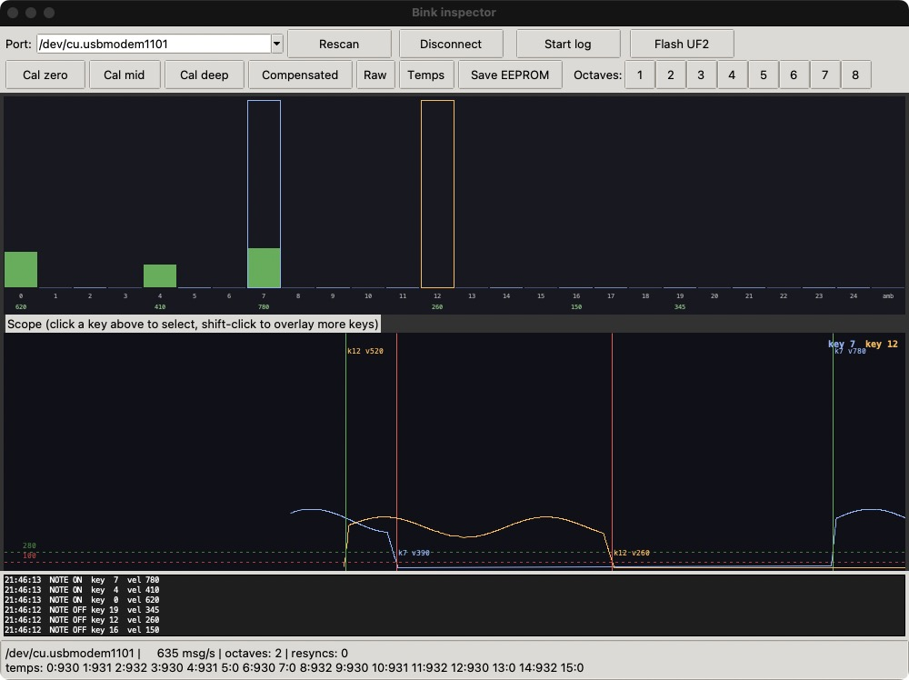

# Bink inspector manual

Installation is covered in the [README](README.md). The protocol behind everything here is described in [`docs/host_protocol.md`](../docs/host_protocol.md).

- [The window](#the-window)
- [Connecting](#connecting)
- [Reading the key strip](#reading-the-key-strip)
- [Using the scope](#using-the-scope)
- [Keybed commands](#keybed-commands)
- [Calibrating a keybed](#calibrating-a-keybed)
- [Setting the octave count](#setting-the-octave-count)
- [Temperatures](#temperatures)
- [Logging to CSV](#logging-to-csv)
- [Flashing firmware](#flashing-firmware)
- [6 and 7 octave keybeds](#6-and-7-octave-keybeds)
- [Terminal monitor](#terminal-monitor)
- [Plotting a log](#plotting-a-log)
- [Troubleshooting](#troubleshooting)

## The window



From top to bottom:

| Area | Purpose |
| --- | --- |
| Connection row | Port selection, `Rescan`, `Connect`, `Start log`, `Flash UF2` |
| Command row | Calibration, data mode, temperatures, saving, octave count |
| Key strip | One bar per key ID |
| Scope | The last 5 seconds of the selected keys |
| Event list | Note events and sent commands, newest first |
| Status bar | Port, message rate, octave count, resyncs, and temperature readings |

## Connecting

On the DevKit board, plug the USB cable into `J4`. Its data lines go straight to the keybed on `J10`, so the computer talks to the keybed itself and the DevKit firmware is not involved. `J102` is the board's own USB port, and the keybed cannot be reached through it.

`J4` and `J102` both supply the board and the keybed, each through its own diode, so either one is enough for power and both can be connected at once.

At start-up the inspector looks for USB ID `B177:4009`, or for the product string `Bink-25`, which every size of keybed uses. If it finds a keybed it connects straight away. Otherwise, pick a port from the list and press `Connect`. `Rescan` refreshes the list.

On connecting, the inspector:

1. Opens the port. The keybed only sends when the port is open with DTR asserted, which is the default.
2. Sends `u`, which moves the stream to USB.
3. Sends `O` every 500 ms until the keybed reports its octave count, and lays out the key strip for that count.

If the keybed gives no answer after 10 tries, a dialog asks for the octave count. The number you enter is sent to the keybed, so enter the right one, or press Cancel to leave the keybed as it is. After Cancel, keys appear in the strip as they report.

`Disconnect` and closing the window send `U`, which gives the stream back to the UART. If the inspector is killed or the cable is pulled, this does not happen, and the keybed stays in USB mode until it is reset.

A keybed at rest sends only its keep-alive, so the status bar shows about 10 msg/s. This is how to tell that the link works when no key is moving.

## Reading the key strip

There is one bar for each ID the keybed sends: 12N + 1 keys and the ambient sensor for an N octave keybed. ID 0 is the lowest C, and the bars run left to right.

| Bar colour | Meaning |
| --- | --- |
| Light blue | White key |
| Dark blue | Black key |
| Green | Note is on |
| Trace colour, with an outline | Key is selected for the scope |

The bar height covers the full range of 0 to 4095. Below each bar is the key ID, and below that in green the velocity of its last note-on or note-off.

The last bar, `amb`, is the ambient magnetic field sensor and not a key. It is processed like a key, so it can show notes if the field around the keybed changes. Ignore them.

## Using the scope

Click a bar to show that key in the scope. Shift-click adds a key to the overlay, or removes it, for up to 8 distinct trace colours. Clicking without Shift goes back to a single key and clears the traces.

- The two dashed lines are the note-on threshold at 280 (green) and the note-off threshold at 100 (red). They apply to compensated mode.
- A green vertical line is a note-on and a red one a note-off. The label gives the key and velocity, so `k7 v780` is key 7 with velocity 780.
- A trace is recorded from the moment its key is selected. There is no history before that.

Velocity is the slope of the key's position at the moment it crosses the threshold. To compare it between keys, overlay them and strike them in turn.

## Keybed commands

| Button | Byte | Effect |
| --- | --- | --- |
| `Cal zero` | `_` | Store the current readings as rest levels |
| `Cal mid` | `-` | Store the current readings as mid levels. Stored, not used by the firmware |
| `Cal deep` | `^` | Store the current readings as deep levels. Stored, not used by the firmware |
| `Compensated` | `C` | Calibrated positions, with notes. The default |
| `Raw` | `R` | ADC readings, without notes |
| `Temps` | `T` | Request the temperature channels |
| `Save EEPROM` | `E` | Write the octave count and calibration to flash |
| `1` to `8` | `1` to `8` | Set the octave count, then read it back |

The keybed does not acknowledge commands. Each one is listed in the event list when it is sent, which only tells you that it left the computer.

In raw mode, the value falls as a key goes down, so a bar at rest is high and drops when pressed. Resting keys also send their noise, so the message rate goes up.

`Compensated` and `Raw` are not saved. The keybed starts in compensated mode.

## Calibrating a keybed

An uncalibrated keybed reports no positions and no notes in compensated mode, because all its rest levels are 0.

1. Check the octave count in the status bar. Correct it if needed, see [Setting the octave count](#setting-the-octave-count). A capture only covers the keys of the current count.
2. Press `Raw` and check that each key's bar responds. This tests the sensors.
3. Let the keybed warm up, and keep your hands off the keys.
4. Press `Cal zero`.
5. Press `Compensated`. All bars should sit at 0.
6. Play every key, and check that each bar rises and that notes appear.
7. Press `Save EEPROM` to keep the result.

A capture takes one reading per key, so keep the keybed still. Without `Save EEPROM` the calibration is lost at power-off.

`Save EEPROM` stops scanning for the length of the flash write, and flash wears out, so use it only when there is something to save, and not while playing.

## Setting the octave count

The octave count is set once for a keybed and kept in flash. Normally you only read it. If it is wrong, the keys come out mixed up.

To change it:

1. Keep your hands off the keys. Notes held at that moment are not released.
2. Press the button for the count. The inspector asks the keybed for the new count and redraws the strip.
3. Calibrate again. Calibration is stored per key ID, so after a change the rest levels belong to other sensors.
4. Press `Save EEPROM`.

Bink keybeds have 1 to 7 octaves. `8` exists in the protocol, with the limitations listed in the host protocol document.

## Temperatures

Press `Temps`. The status bar then lists the 16 channels as `channel:value`, in raw 12-bit ADC counts. The keybed also sends them when the inspector connects.

```
celsius = (value * 3.3 / 4095 - 0.5) / 0.01
```

About 930 is 25 °C. Channels 0 and 8 are the two octaves of the main sensor board. Without an extension board the others mean nothing. See [Temperature](../docs/host_protocol.md#temperature) for the full channel map.

## Logging to CSV

`Start log` writes every message to `bink_log_YYYYMMDD_HHMMSS.csv` in the folder the inspector was started from. The event list shows the name. `Stop log` closes the file.

| Column | Contents |
| --- | --- |
| `t` | Seconds since the inspector started, as the message arrived on the computer |
| `id` | Message ID |
| `type` | `VAL`, `ON`, `OFF` or `STAT` |
| `value` | Position, velocity or reading |

The times are arrival times. USB delivers bytes in bursts, so they do not show the keybed's exact timing.

## Flashing firmware

1. Put the board in BOOTSEL mode by holding BOOTSEL while plugging it in. It appears as a USB drive.
2. Press `Flash UF2`.
3. Choose the firmware file. The picker starts in `firmware/build` if you have built the DevKit firmware.

The file is copied to **every** RP2 drive that is mounted, so keep only the board you mean to flash in BOOTSEL mode. The DevKit firmware, `Bink_DevKit.uf2`, is for the DevKit board and not for the keybed.

The board restarts when the copy ends. About 2.5 seconds later the inspector looks for a keybed and connects if it finds one.

## 6 and 7 octave keybeds

6 and 7 octave keybeds have a second Bink-25 at the other end of the keyboard, with its own `TO HOST` cable, and each half appears as a separate keybed. Both report the same USB ID and serial number, so automatic detection takes the first one it finds. Each half needs its own USB connection; `J4` on the DevKit only reaches the keybed on `J10`. Run one inspector per half, and name the ports:

```sh
python3 bink_gui.py /dev/cu.usbmodem1101
python3 bink_gui.py /dev/cu.usbmodem1103
```

## Terminal monitor

`bink_monitor.py` shows the same data as text, which is useful over SSH or for watching a UART stream.

```sh
python3 bink_monitor.py                     # find the keybed by USB ID
python3 bink_monitor.py COM7                # use this port
python3 bink_monitor.py COM7 --log run.csv  # also log to a CSV file
python3 bink_monitor.py COM7 --uart         # listen only
```

| Key | Action |
| --- | --- |
| `z` `m` `h` | Capture zero, mid and deep levels |
| `c` `r` | Compensated, raw |
| `t` `o` | Request temperatures, request octave count |
| `1` to `8` | Set the octave count |
| `E` | Save to flash |
| `l` | Start or stop logging |
| `q` | Quit |

On macOS and Linux, press Enter after each key. On Windows the key acts immediately.

With `--uart` the monitor sends nothing when it starts or quits, so it can decode the keybed's UART stream through a USB serial adapter that handles 1,000,000 baud, connected to `D0` and ground. This is a 3.3 V signal. The commands in the table above would go out on the adapter's transmit line, which is not the keybed's 115,200 baud command input, so use this mode only to listen.

## Plotting a log

Plotting needs matplotlib:

```sh
pip install matplotlib
python3 bink_monitor.py plot run.csv --id 17
```

This shows the position of key 17 over the whole recording, with its note-ons and note-offs. `--id` defaults to key 0.

## Troubleshooting

| Symptom | Cause and fix |
| --- | --- |
| No keybed found at start-up | On a DevKit, check that the cable is in `J4` and not `J102`, and that the keybed's FFC is in `J10`. Then press `Rescan`, or choose the port by hand. |
| `Could not open` the port | Another program has the port open, or on Linux your user is not in the `dialout` group. |
| `No module named 'serial'` | Activate the virtual environment, or run `pip install -r requirements.txt`. Install `pyserial`, not `serial`. |
| `No module named '_tkinter'` | Install Tk for your Python, see the [README](README.md#installation). |
| 0 msg/s while connected | The keybed is not sending. Reconnect, and check that this is the keybed's port. |
| About 10 msg/s, and keys do not move | The keybed is not calibrated. Press `Raw` to check the sensors, then see [Calibrating a keybed](#calibrating-a-keybed). |
| Resting keys show a value | The rest levels are out of date. Repeat the calibration, for example after a large change in temperature. |
| Bars respond to the wrong keys | The octave count is wrong. See [Setting the octave count](#setting-the-octave-count). |
| Bars are high at rest and fall when pressed | The keybed is in raw mode. Press `Compensated`. |
| No notes appear, but bars move | The keybed is in raw mode, or the keys do not reach the threshold of 280. |
| Notes on `amb` | A changing magnetic field near the keybed. These are not key presses. |
| `resyncs` keeps rising | The stream is arriving damaged. Check the cable and try another USB port. |
| A note stays green | A note-off was lost because the computer read too slowly. The keybed does not resend it. The next press of that key clears it. |
| The DevKit gets no keys after using the inspector | The keybed is still in USB mode. Connect and disconnect the inspector, or reset the keybed. |
