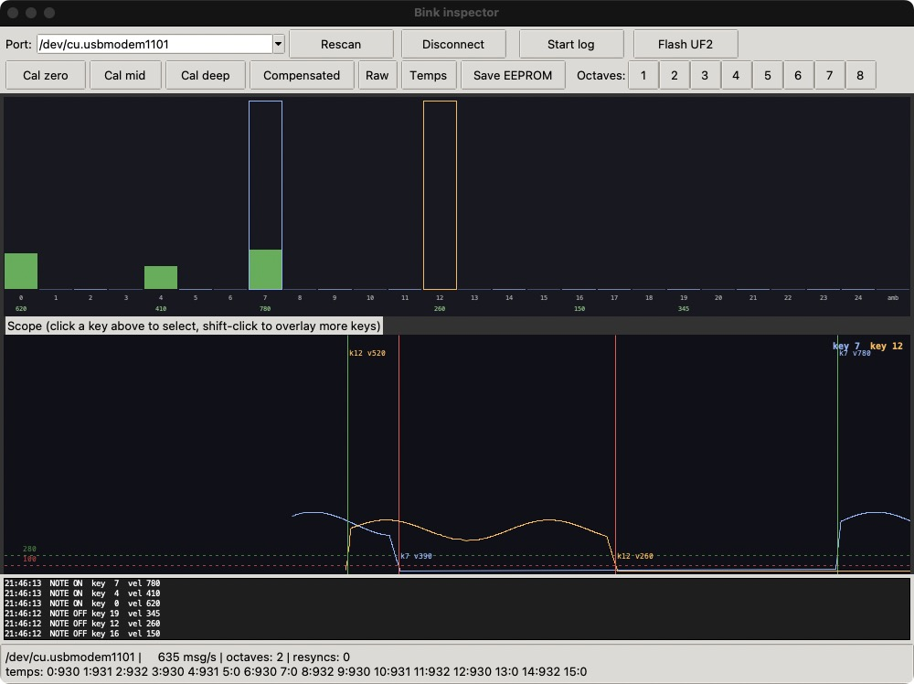

# Bink inspector

Desktop tools for looking at what a Bink keybed sends: live key positions, note events, velocities and temperatures. Use them to bring up a keybed, calibrate it, check its velocity behaviour, and record its data for analysis.



*The window with a 2 octave keybed, keys 7 and 12 selected in the scope. Taken with a simulated key stream.*

| File | Contents |
| --- | --- |
| `bink_gui.py` | The inspector window |
| `bink_monitor.py` | The same stream in a terminal, plotting of recorded logs, and the protocol decoder used by the window |
| [`MANUAL.md`](MANUAL.md) | How to use both, with calibration steps and troubleshooting |

## What it does

- Shows every key as a live bar, with its last velocity
- Plots selected keys on a 5 second scope with note-on and note-off markers and the 280 and 100 thresholds
- Lists note events as they arrive
- Sends calibration, data mode and octave commands to the keybed
- Reports message rate, protocol errors, octave count and temperature readings
- Logs every message to a CSV file
- Copies a UF2 firmware file to a board in BOOTSEL mode

## Requirements

- Python 3 with Tk
- [pyserial](https://pypi.org/project/pyserial/)
- A keybed connected over USB, see [Connecting the keybed](#connecting-the-keybed)
- matplotlib, only for plotting logs

## Installation

```sh
cd inspector
python3 -m venv .venv
source .venv/bin/activate        # Windows: .venv\Scripts\activate
pip install -r requirements.txt
```

Tk comes with the python.org installers for macOS and Windows. Elsewhere it is a separate package:

| System | Command |
| --- | --- |
| macOS, Homebrew Python | `brew install python-tk` |
| Debian, Ubuntu | `sudo apt install python3-tk` |
| Fedora | `sudo dnf install python3-tkinter` |

On Linux, your user needs access to the serial port. On most distributions this means the `dialout` group:

```sh
sudo usermod -aG dialout $USER
```

Log out and back in afterwards.

## Connecting the keybed

On the DevKit board, connect the computer to `J4`, the USB-C port that passes through to the keybed. `J102` is the board's own USB port and does not reach the keybed. `J4` also powers the keybed and the board, so one cable is enough.

Without a DevKit board, the USB lines are pins 1 and 2 of the `TO HOST` connector, see [`keybed/README.md`](../keybed/README.md).

## Running

Start the window:

```sh
python3 bink_gui.py
```

It finds the keybed by its USB ID and connects. To choose the port yourself:

```sh
python3 bink_gui.py /dev/cu.usbmodem1101
python3 bink_gui.py COM7
```

Press a key. Its bar rises and turns green, and a note-on appears in the list at the bottom. If nothing moves, the keybed probably has no calibration yet: see [Calibrating a keybed](MANUAL.md#calibrating-a-keybed).

While the inspector is connected the keybed sends its stream over USB and not over the UART, so a DevKit board on the same keybed receives no keys until you press `Disconnect` or close the window.

See [`docs/host_protocol.md`](../docs/host_protocol.md) for the protocol itself.
